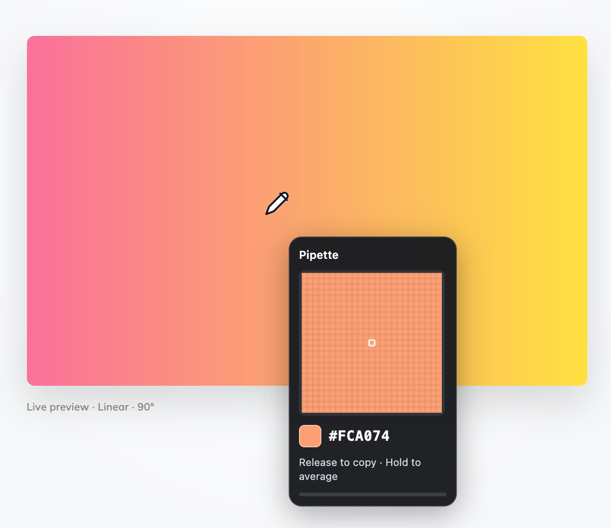

# Pipette

A color picker for Firefox that lets you pick a single pixel or hold to average
a growing area. Find a representative color in gradients, photos, and textured
backgrounds, then copy it as a HEX value.

Supports Firefox desktop (140+) and Firefox for Android (142+).



Gradient: [WebGradients](https://webgradients.com/).

## Use Pipette

1. Click the Pipette toolbar icon to activate the picker.
2. Point at a color. Click for a single pixel, or hold to expand the sampling area.
3. Release to copy the color. The magnifier shows what you're picking.

On Android, open Firefox's **Extensions** menu and tap **Pick a color**. Touch and
drag to position the sample, hold to average, and lift your finger to copy.

Press **Escape** or activate Pipette again to cancel. Keyboard users can activate
with **Alt+Shift+Y**, move with the **arrow keys**, and hold and release **Space**
to sample.

Right-click the toolbar icon and choose **Settings**, or open Pipette's preferences
in Firefox's add-on manager, to adjust the hold timing and sampling shape.
Changes save automatically and apply the next time you activate the picker.

Firefox protects some pages from extensions. If the picker doesn't open, try a
regular website.

## Try it locally

Install Node.js 22+ and pnpm, then build the add-on:

```sh
git clone https://github.com/PaulRenvoise/firefox-colorpicker-addon.git
cd firefox-colorpicker-addon
pnpm install --frozen-lockfile
pnpm build
```

In desktop Firefox, open `about:debugging#/runtime/this-firefox`, choose
**Load Temporary Add-on**, and select `dist/manifest.json`.

## Development

Run `pnpm start` to build the add-on and launch a temporary Firefox profile with
Pipette loaded.

| Command | Purpose |
| --- | --- |
| `pnpm test` | Run unit tests |
| `pnpm lint` | Validate the extension |
| `pnpm test:browser` | Run Firefox integration tests |
| `pnpm package` | Create an unsigned archive in `artifacts/` |

For Android development, follow [Mozilla's device setup guide](https://extensionworkshop.com/documentation/develop/developing-extensions-for-firefox-for-android/),
then run:

```sh
pnpm start:android --adb-device DEVICE_ID --firefox-apk org.mozilla.firefox
```

To distribute a build, follow [Mozilla's signing and distribution guide](https://extensionworkshop.com/documentation/publish/signing-and-distribution-overview/).

## Privacy

Color picking happens locally. Pipette doesn't store or upload screenshots or
picked colors. Your settings stay in your Firefox profile.
